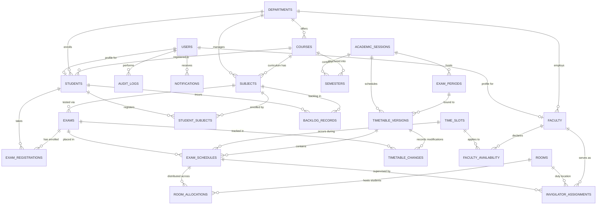

# Entity-Relationship (ER) Documentation & Diagram

## Relational Architecture Overview
The system is built on a 24-entity relational schema with explicit referential integrity, cascading rules, and index optimization.

## Core Entities & Relational Schema
1. **users**: User identity, hashed passwords, roles (`admin`, `faculty`, `student`).
2. **departments**: College academic units (e.g., Computer Science, Mechanical).
3. **academic_sessions**: Academic years/semesters (e.g., 2026-2027 Odd Semester).
4. **courses**: Degree programs (e.g., B.Tech CSE, M.Tech AI).
5. **semesters**: Semester terms linked to courses and sessions.
6. **students**: Student profile and enrollment details linked to `users`.
7. **faculty**: Faculty profile, designation, max duty limits linked to `users`.
8. **subjects**: Catalog of theory, lab, practical, and elective subjects.
9. **student_subjects**: Registration ledger linking students to enrolled subjects.
10. **exams**: Concrete examination events (Regular, Backlog, Practical, Supplementary).
11. **exam_registrations**: Actual student entries for a given exam event.
12. **exam_periods**: High-level calendar window, working day masks, and holiday lists.
13. **time_slots**: Standard slots (e.g., 09:30-12:30 Morning, 14:00-17:00 Afternoon).
14. **rooms**: Examination venues with seating capacities, building, floor, equipment.
15. **timetable_versions**: Timetable snapshots with state machine transitions.
16. **exam_schedules**: Specific exam-to-date-and-time-slot mappings.
17. **room_allocations**: Capacity allocation of rooms to scheduled examinations.
18. **faculty_availability**: Date/slot availability constraints declared by faculty.
19. **invigilator_assignments**: Faculty assigned to invigilate rooms for exam slots.
20. **scheduling_constraints**: Hard/soft constraint configuration with penalty weights.
21. **timetable_changes**: Granular history of manual modifications.
22. **notifications**: Notification dispatch queue and logs.
23. **backlog_records**: Historical failed subjects awaiting clearance.
24. **audit_logs**: Immutable trace of all administrative updates.
